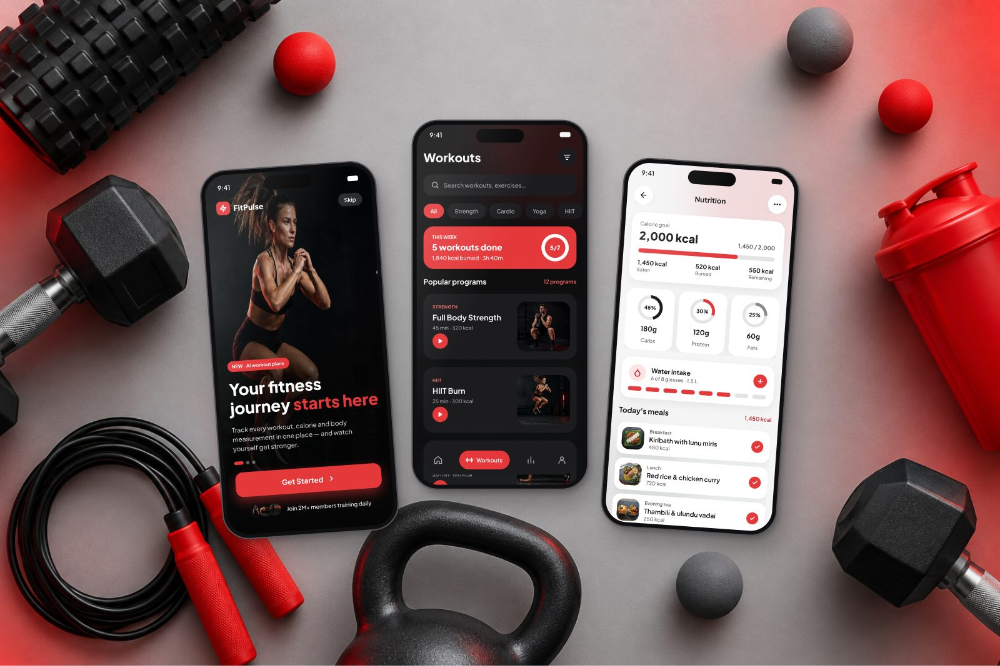
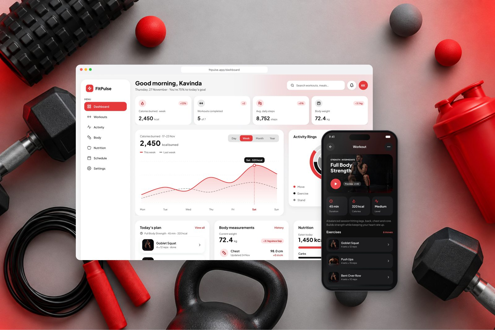

# FitPulse — Fitness Tracker

A fitness tracker that keeps your **workouts, calories burned, nutrition and body measurements in one place**.
It works on desktop and mobile, has Light and Dark modes, and includes a Sri Lankan meal plan.




**Live demo:** https://kavinda-kalum.github.io/fitpulse-gym/ *(after you deploy, see below)*

## Features

- **Dashboard**: today's progress ring, weekly calories chart (hover the points), activity rings, today's plan, body summary, nutrition and workout history
- **Weekly schedule** from the gym guide: Chest + Triceps, Back + Biceps, Legs + Abs, Shoulders + Traps, Chest + Back, Arms + Abs, then Rest. Today is highlighted.
- **8 gym programs** with sets × reps × kg and rest times, plus Glute Builder and Cardio & Conditioning
- **Exercise library**: 99 exercises in 10 muscle groups (chest, back, shoulders, biceps, triceps, legs, abs & core, forearms & grip, glutes, cardio). Search them, filter by muscle, and see the recommended sets, reps and rest. Tap **+** to build **My Workout** and run it in the player.
- Sets/reps/rest guidelines and training & safety tips
- **Personal records** for bench, squat, deadlift and shoulder press
- **Set-by-set gym player**: adjust the weight, tap **Set done**, and a rest countdown starts automatically (with a beep). Finished sessions are added to your history, volume and calories.
- **Activity**: switch between week and month, calories vs last period, steps, and calories burned by workout type
- **Body**: weight trend, goal progress, BMI, body fat and muscle, and 6 body measurements. **Log measurement** saves new values.
- **Nutrition (Sri Lankan meal plan)**: kiribath, rice & curry, thambili & vadai, egg hoppers. Log or unlog meals, quick-add favourites like kottu or string hoppers, track water and macros.
- Onboarding screen, Light/Dark mode (follows your system setting), keyboard and screen-reader friendly, responsive layout
- Everything you log is saved in the browser (`localStorage`). Use **Reset demo data** (at the bottom of every page) to start over.

## Tech

Plain **HTML, CSS and JavaScript**. No framework and no build step, so GitHub Pages serves the files as they are.

```
fitpulse/
├── index.html          # app shell + icon sprite
├── css/styles.css      # design tokens (light/dark), layout, components
├── js/data.js          # demo data: workouts, meals, measurements… edit here
├── js/charts.js        # tiny SVG charts (rings, line, bars)
├── js/app.js           # routing, views, interactions, localStorage
└── assets/             # photos, showcase images, favicon
```

## Run locally

Open `index.html` in a browser, or start a small server:

```bash
cd fitpulse-gym
python -m http.server 8000
# open http://localhost:8000
```

## Deploy to GitHub Pages

1. Create a new **public** repository on GitHub named `fitpulse-gym`. Don't add a README.
2. Push this folder to it:
   ```bash
   cd fitpulse-gym
   git init
   git add .
   git commit -m "FitPulse fitness tracker"
   git branch -M main
   git remote add origin https://github.com/kavinda-kalum/fitpulse-gym.git
   git push -u origin main
   ```
3. On GitHub, go to **Settings → Pages**. Under **Build and deployment**, set **Source: Deploy from a branch**, **Branch: `main`**, folder **`/ (root)`**, then **Save**.
4. After about a minute the site is live at **https://kavinda-kalum.github.io/fitpulse-gym/**

## Credits

UI design by Kavinda Kalum (designed in Figma). Photos are AI-generated for this project.
Font: [Plus Jakarta Sans](https://fonts.google.com/specimen/Plus+Jakarta+Sans).
